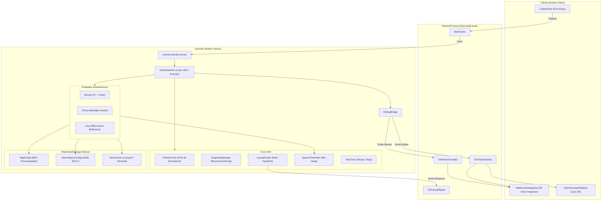

# 5D Multiverse FNAF Engine — Documentación y Arquitectura del Proyecto

Este repositorio contiene la implementación en **Roblox (Luau)** de un motor multiversal inspirado en la mecánica de *5D Chess with Multiverse Time Travel* adaptada al universo de *Five Nights at Freddy's (FNAF)*, desarrollado para la aplicación de algoritmos y estructuras de datos avanzadas (ADA).

El sistema cuenta con gestión de causalidad temporal, relojes vectoriales, ramificación en árbol de líneas temporales, ordenamiento topológico para la propagación de efectos ("efecto mariposa"), búsqueda heurística $A^*$ espacio-temporal y una interfaz visual 2D interactiva de depuración.

---

## 📑 Tabla de Contenidos

1. [Métricas y Resumen General](#-métricas-y-resumen-general)
2. [Inventario Completo de Archivos](#-inventario-completo-de-archivos)
3. [Archivos a Eliminar o Consolidar (Limpieza Inmediata)](#-archivos-a-eliminar-o-consolidar-limpieza-inmediata)
4. [Archivos a Dividir / Modularizar (Refactorización por Líneas de Código)](#-archivos-a-dividir--modularizar-refactorización-por-líneas-de-código)
5. [Arquitectura del Sistema y Flujo de Datos](#-arquitectura-del-sistema-y-flujo-de-datos)

---

## 📊 Métricas y Resumen General

| Categoría | Archivos | Líneas Totales | Tamaño Total |
| :--- | :---: | :---: | :---: |
| **Cliente / UI (`StarterPlayerScripts` + `StarterGui`)** | 3 | 1,692 líneas | 70.37 KB |
| **Núcleo Servidor (`ServerScriptService/Modules/Core`)** | 6 | 972 líneas | 34.30 KB |
| **Entidades / Animatrónicos (`ServerScriptService/Modules`)** | 6 | 682 líneas | 31.59 KB |
| **Compartido (`ReplicatedStorage/Shared`)** | 4 | 694 líneas | 27.71 KB |
| **Depuración y Controladores (`ServerScriptService`)** | 3 | 448 líneas | 18.94 KB |
| **TOTAL PROYECTO** | **22** | **~4,488 líneas** | **~183 KB** |

---

## 📂 Inventario Completo de Archivos

A continuación se detalla la función de cada archivo del repositorio, ordenados por ubicación y con su métrica de líneas:

### 1. `ReplicatedStorage/Shared/` (Módulos Compartidos Cliente-Servidor)

*   **`RoomSpaceConfig.luau`** (386 líneas | 14.11 KB)
    *   **Propósito:** Define la matriz maestra del mapa aéreo 2D ($30 \times 17$ celdas) y las especificaciones físicas de las 9 salas transitables (metros, studs, colisiones, spawns, etiquetas).
    *   **Algoritmo incluido:** Implementa `encontrarCaminoPacMan` (BFS sobre la grilla) para la navegación bloque a bloque del jugador y conversión entre metros y studs.
*   **`MapGraph.luau`** (144 líneas | 6.64 KB)
    *   **Propósito:** Modela el grafo abstracto topológico del restaurante (9 nodos principales incluyendo `FuenteEnergia` y `Oficina` con restricción de grado 2).
    *   **Algoritmo incluido:** Precomputa con **BFS** la matriz de distancias mínimas $O(1)$ admisible para $A^*$, y administra aristas dinámicas (apertura/cierre de puertas).
*   **`VectorClock.luau`** (95 líneas | 4.16 KB)
    *   **Propósito:** Implementa **Relojes Lógicos de Lamport** y **Relojes Vectoriales (Vector Clocks)** para sincronización de causalidad entre múltiples líneas temporales sin depender de un reloj físico global. Permite determinar relaciones *happens-before* ($A \to B$) y concurrencia ($A \parallel B$).
*   **`NetworkProtocol.luau`** (69 líneas | 2.80 KB)
    *   **Propósito:** Fábrica de `RemoteEvent` (Lobby, Deltas temporales, Ramificación y Ondas causales) y definición de tipos TypeScript/Luau (`DeltaPayload`, `GameStateType`).

---

### 2. `ServerScriptService/` (Lógica del Servidor)

#### Controlador Principal
*   **`GameController.server.luau`** (64 líneas | 3.56 KB)
    *   **Propósito:** Script autoritativo que inicializa el servidor en estado `LOBBY`, conecta la sesión a `DebugBridge` y escucha la solicitud `StartGame` de los clientes para iniciar la noche de 140 segundos.

#### `ServerScriptService/Modules/Core/` (Algoritmos y Estructuras de Datos)
*   **`SnapshotManager.luau`** (208 líneas | 8.75 KB)
    *   **Propósito:** Estructura de datos inmutable persistente con **Structural Sharing** (Event Sourcing). Registra deltas incrementales en lugar de clonar todo el estado del juego, logrando una complejidad espacial de $O(E)$ en vez de $O(|V| \cdot T \cdot |L|)$.
*   **`GameSession.luau`** (203 líneas | 10.03 KB)
    *   **Propósito:** Encapsulador de la sesión de juego. Coordina el bucle de simulación, la gestión de energía, el drenaje acelerado por puertas cerradas, la detección de colisiones animatrónico-oficina y la condición de victoria/derrota.
*   **`TimelineTree.luau`** (194 líneas | 8.01 KB)
    *   **Propósito:** Árbol dirigido (DAG) de líneas de tiempo multiversales ($L_0, L_1, \dots$). Gestiona la creación de ramas temporales, el avance de tiempo local independiente y el cálculo de la línea temporal activa más vulnerable.
*   **`SpaceTimeAStar.luau`** (137 líneas | 5.14 KB)
    *   **Propósito:** Búsqueda de caminos en el espacio-tiempo 4D $(u, t, L)$ mediante **$A^*$** asistido por una cola de prioridad basada en un **Min-Heap Binario** en $O((|V| + |E|) \log |V|)$.
*   **`CausalGraph.luau`** (134 líneas | 5.78 KB)
    *   **Propósito:** Resuelve la propagación causal del "Efecto Mariposa" mediante el **Algoritmo de Ordenamiento Topológico de Kahn**. Cuando una acción modifica el pasado, propaga de forma acíclica los cambios hacia las ramas descendientes.
*   **`SimClock.luau`** (96 líneas | 2.59 KB)
    *   **Propósito:** Reloj de simulación virtual desacoplado del tiempo real de Roblox. Permite pausar el juego, ejecutar avance paso a paso (*step-by-step*) y acelerar la velocidad del motor.

#### `ServerScriptService/Modules/Entities/` (Jerarquía de Clases POO)
*   **`TemporalEntity.luau`** (43 líneas | 1.77 KB)
    *   **Propósito:** Clase base abstracta para entidades existentes en el espacio-tiempo. Define posición espacial $(x, y)$, sala actual, línea temporal y reloj vectorial propio.
*   **`MultiversePlayer.luau`** (79 líneas | 3.93 KB)
    *   **Propósito:** Subclase de `TemporalEntity`. Representa al guardia de seguridad; gestiona el viaje entre escenarios temporales paralelos y la interacción con puertas y objetos.
*   **`Animatronico.luau`** (246 líneas | 11.18 KB)
    *   **Propósito:** Clase base de los animatrónicos. Implementa la tirada de movimiento `math.random(1, 20) <= enojo`, subrutinas en hilos independientes, detección de puertas cerradas y lógica de retroceso de 5 segundos al origen.
*   **`Bonnie.luau`** (126 líneas | 5.98 KB)
    *   **Propósito:** Implementación de Bonnie. Reloj interno de 3s. Usa poda de candidatos y evalúa caminos alternativos con $A^*$ o saltos interdimensionales si la puerta izquierda está bloqueada.
*   **`Chica.luau`** (106 líneas | 4.88 KB)
    *   **Propósito:** Implementación de Chica. Reloj interno de 5s. Demora 2s por nodo; al pasar por baños ejecuta un sabotaje energético que detona el *Efecto Mariposa* vía `CausalGraph`.
*   **`Foxy.luau`** (82 líneas | 3.82 KB)
    *   **Propósito:** Implementación de Foxy. Reloj interno de 7s. Mecánica de 3 fases en Cueva Pirata, sprint por pasillo izquierdo y capacidad de abrir brechas temporales (bifurcaciones en el árbol de multiversos).

#### `ServerScriptService/Modules/Debug/`
*   **`DebugBridge.luau`** (240 líneas | 8.74 KB)
    *   **Propósito:** Servidor de depuración. Traduce los estados internos de `GameSession`, `TimelineTree` y `MapGraph` a paquetes de red para alimentar la interfaz gráfica en tiempo real.

#### ⚠️ Archivo Duplicado en Servidor
*   **`ServerScriptService/Modules/MapGraph.luau`** (144 líneas | 6.64 KB)
    *   *Nota:* Duplicado idéntico de `ReplicatedStorage/Shared/MapGraph.luau`. Ver sección de limpieza.

---

### 3. `StarterGui/` y `StarterPlayerScripts/` (Lógica del Cliente)

*   **`StarterGui/LobbyGui/LobbyClient.client.luau`** (103 líneas | 4.11 KB)
    *   **Propósito:** Controlador de la interfaz del Lobby. Controla el botón de inicio de partida, coordina la visibilidad con el panel de depuración para evitar superposiciones y solicita el arranque mediante `NetworkProtocol.StartGame`.
*   **`StarterPlayerScripts/ClientScenarioReplica.client.luau`** (58 líneas | 3.02 KB)
    *   **Propósito:** Arquitectura de hidratación perezosa (*Lazy Viewport Hydration*). Mantiene en memoria 3D únicamente el escenario donde está la cámara del jugador, actualizando el resto en un minimapa 2D ligero para ahorrar el 95% de recursos gráficos.
*   **`StarterPlayerScripts/MultiverseDebugGui.client.luau`** (1,531 líneas | 63.24 KB) ⚠️ **MONOLÍTICO**
    *   **Propósito:** Interfaz gráfica 2D integral de desarrollo. Genera dinámicamente el Canvas del mapa $30 \times 17$, dibuja celdas, puertas, pines de salas, tokens animados de animatrónicos con interpolación, navegación del jugador (WASD/flechas/clic), botones de puertas funcionales, selector de líneas temporales, timeline slider, log de eventos y controles de pausa/paso.

---

## 🗑️ Archivos a Eliminar o Consolidar (Limpieza Inmediata)

### 1. Eliminar archivo duplicado: `ServerScriptService/Modules/MapGraph.luau`
*   **Diagnóstico:** Es **100% idéntico** a `ReplicatedStorage/Shared/MapGraph.luau` (la única diferencia era una línea de comentario).
*   **Riesgo actual:** Duplicidad de código. Si se corrige o añade una sala en uno, el otro queda desincronizado.
*   **Acción recomendada:**
    1. En `src/ServerScriptService/Modules/Core/GameSession.luau`, cambiar:
       ```luau
       -- ANTES:
       local MapGraph = require(Modules:WaitForChild("MapGraph"))
       -- DESPUÉS:
       local MapGraph = require(Shared:WaitForChild("MapGraph"))
       ```
    2. **Eliminar** el archivo `src/ServerScriptService/Modules/MapGraph.luau`.
    3. Mantener únicamente la copia compartida en `src/ReplicatedStorage/Shared/MapGraph.luau` para que tanto el Cliente como el Servidor consuman el mismo módulo.

### 2. Eliminar directorio vacío: `Mecanicas/`
*   **Diagnóstico:** Directorio vacío en la raíz del proyecto sin ningún archivo rastreado ni script.
*   **Acción recomendada:** Eliminar la carpeta `Mecanicas/` si no se va a usar para documentación externa.

### 3. Evaluar rol de: `StarterPlayerScripts/ClientScenarioReplica.client.luau`
*   **Diagnóstico:** Archivo de 58 líneas que actualmente solo imprime mensajes por consola cuando llegan deltas (`print(...)`).
*   **Acción recomendada:** **NO eliminarlo aún**, pero marcarlo como *Stub / Prototipo*: servirá en el futuro cuando se conecten los modelos 3D físicos del Workspace con el motor del juego.

---

## ✂️ Archivos a Dividir / Modularizar (Refactorización por Líneas de Código)

### 🔴 Prioridad 1: `MultiverseDebugGui.client.luau` (1,531 líneas)
Este archivo concentra más del 34% de todo el código del proyecto y viola el principio de responsabilidad única (*Single Responsibility Principle*). Mezcla generación de instancias UI, renderizado de grilla, física de movimiento en UI, inputs de teclado y sincronización de red.

#### Plan de División Recomendado:
Crear una carpeta `src/StarterPlayerScripts/DebugGui/` y descomponerlo en 5 módulos especializados:

```
src/StarterPlayerScripts/DebugGui/
├── DebugController.client.luau      (~120 líneas) -> Orquestador principal, red y ciclo de vida
├── DebugUIBuilder.luau              (~350 líneas) -> Creación de ScreenGui, TopBar, Canvas y Paneles
├── MapGridRenderer.luau             (~350 líneas) -> Dibuja celdas 30x17, colores de salas, puertas y props
├── AnimatronicRenderer.luau         (~250 líneas) -> Gestión de tokens circulares, tweens y etiquetas
└── PlayerNavigation.luau            (~280 líneas) -> Input WASD/flechas/clic, pathfinding Pac-Man y pasos
```

*   **Beneficio:** Facilita corregir bugs visuales sin tocar la lógica de movimiento y reduce el tamaño de cada archivo a menos de 350 líneas legibles y testeables.

---

### 🟡 Prioridad 2: `RoomSpaceConfig.luau` (386 líneas)
Actualmente mezcla datos puramente declarativos de configuración con algoritmos de búsqueda.

#### Plan de División Recomendado:
1. **`RoomSpaceConfig.luau` (~280 líneas):** Mantener solo la declaración de tipos (`TileTipo`, `PuertaInfo`, `CeldaMapa`, `RoomConfig`), la tabla de salas `SALAS` y la matriz de grilla 2D.
2. **`GridPathfinder.luau` (~110 líneas en `ReplicatedStorage/Shared/`):** Extraer la función `encontrarCaminoPacMan` y funciones de conversión de coordenadas (`celdaANormalizadoEnSala`, `metrosAStuds`).

---

### 🟢 Prioridad 3: `Animatronico.luau` (246 líneas) y `DebugBridge.luau` (240 líneas)
*   **Estado:** Ambos están en un rango de longitud aceptable (200-250 líneas) y con responsabilidades cohesivas.
*   **Recomendación:** **Mantener como están.** No requieren división inmediata a menos que se agreguen más de 100 líneas adicionales de lógica.

---

## 🔄 Arquitectura del Sistema y Flujo de Datos



---

*Documentación generada automáticamente para mantenimiento y optimización del código fuente.*
